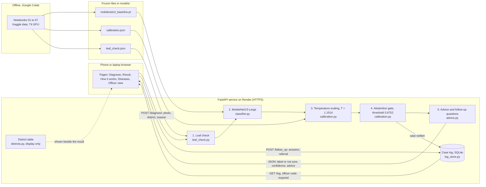

# System architecture

## Components

| Part | Where | Job |
|---|---|---|
| Pages | `api/static/` | Five static pages (HTML, Tailwind, JavaScript). They only call the API; no diagnosis logic runs in the browser. |
| Routes | `api/main.py` | `/diagnose`, `/follow_up`, `/log`, `/districts`, `/health` and the pages. Routes only. |
| Officer access | `api/main.py`, `require_officer` | `/log` answers only when the request carries the officer access code, compared on the server with the `CASSACHECK_OFFICER_CODE` environment variable. Without the variable the log is closed (503); a wrong or missing code gets 401. Farmers have no account and their menu has no officer link. |
| Leaf check | `api/leaf_check.py` | Refuses a photo whose plant-colour fraction is below the cut-off in `models/leaf_check.json` (notebook 06), before the model. |
| Classifier | `api/classifier.py` | MobileNetV3-Large, 224 by 224 centre crop, five class scores. |
| Calibration and abstention | `api/calibration.py` | Divides the scores by the temperature, then answers only above the threshold. Both values come from `models/calibration.json` (notebook 04b) and are never refitted on the server. |
| Advice | `api/advice.py` | Management advice and four follow-up questions, stored as data. A test checks that no chemical or dose is named. |
| District table | `api/districts.py`, `data/district_prevalence.csv` | Published survey values shown beside the result. They never change the diagnosis. |
| Case log | `api/log_store.py` | SQLite file created at start-up: case number, date, district, season, decision, confidence, answers, referral. No names, phone numbers or photos. |

## Deployment

One Render web service defined in `render.yaml` (free plan, Python 3.12, CPU-only PyTorch from `requirements-deploy.txt`). Every push to `main` redeploys it. The free plan sleeps when idle and clears the case log on restart, so the log holds demonstration data; a PostgreSQL database is the step for real use. Details in `docs/deployment_plan.md`.

Training and evaluation run offline in Google Colab (notebooks 01 to 07). The server only loads the frozen files in `models/`.
